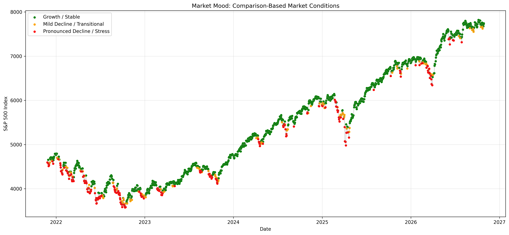

# 📈 Market Mood
### Discovering Stock Market Regimes Using Unsupervised Machine Learning

Market Mood is a Python-based data mining project that explores how unsupervised machine learning can identify distinct market conditions using historical S&P 500 data.

Rather than assigning predefined market labels, the project uses K-Means and hierarchical clustering to group trading days according to their return, volatility, and momentum characteristics.

The analysis identifies two broad market regimes and investigates how disagreements between clustering algorithms reveal additional patterns in market behavior.

## Project Objectives

- Identify interpretable market conditions using unsupervised clustering.
- Compare K-Means and hierarchical clustering.
- Evaluate the effect of correlated features on clustering performance.
- Visualize discovered market regimes across historical S&P 500 movements.
- Investigate observations classified differently by the two algorithms.

## Dataset

**Source:** Federal Reserve Economic Data (FRED) — S&P 500 Index (`SP500`)

**Period:** October 2021 – October 2026

The original dataset contained 1,305 observations. After removing missing closing values and preparing rolling-window features, the final modeling dataset contained **1,235 observations**.

### Feature Engineering

The following features were used for clustering:

| Feature | Description |
|---|---|
| Daily Return | Percentage change between consecutive trading days |
| 5-Day Return | Percentage change over five trading days |
| 20-Day Return | Percentage change over twenty trading days |
| 20-Day Volatility | Rolling standard deviation of daily returns |
| 20-Day Momentum | Relative difference between the index and its 20-day moving average |

Features were standardized using `StandardScaler` before clustering.

## Methodology

### 1. Exploratory Data Analysis

Historical S&P 500 values, rolling volatility, and daily return distributions were examined to understand market behavior.

Correlation analysis identified overlapping information among return and momentum features, motivating a feature-removal experiment.

### 2. K-Means Clustering

K-Means was evaluated using cluster counts from 2 through 6.

The highest silhouette score was **0.369**, achieved with two clusters using all five features.

### 3. Feature-Removal Experiment

A second K-Means experiment removed the 20-day momentum feature to investigate the effect of correlated variables.

The highest silhouette score decreased to **0.332**, suggesting that removing momentum did not improve the best-performing configuration.

### 4. Hierarchical Clustering

Agglomerative hierarchical clustering with Ward linkage was evaluated using the original five standardized features.

The highest silhouette score was **0.380**, achieved with two clusters.

### 5. Cross-Model Comparison

K-Means and hierarchical clustering were compared using the Adjusted Rand Index (ARI), producing a score of **0.584**.

The algorithms agreed on 1,105 of 1,235 observations and disagreed on 130.

## Experimental Results

| Number of Clusters | K-Means | Reduced K-Means | Hierarchical |
|---|---:|---:|---:|
| 2 | 0.369 | 0.332 | **0.380** |
| 3 | 0.313 | 0.330 | 0.185 |
| 4 | 0.244 | 0.236 | 0.176 |
| 5 | 0.256 | 0.237 | 0.187 |
| 6 | 0.257 | 0.242 | 0.153 |

*Values represent silhouette scores; higher values generally indicate better-separated clusters.*

Hierarchical clustering with two clusters achieved the highest silhouette score among the tested configurations, although its advantage over K-Means was modest.

## Market Regime Interpretation

Comparing the two algorithms produced three descriptive categories:

| Market Condition | Observations | Percentage |
|---|---:|---:|
| Growth / Stable | 900 | 72.9% |
| Mild Decline / Transitional | 130 | 10.5% |
| Pronounced Decline / Stress | 205 | 16.6% |

These categories are derived from agreement and disagreement between two binary clustering solutions, rather than from a standalone three-cluster model.

The disagreement group showed moderately negative returns and momentum, while the shared stress group exhibited more pronounced declines.

## Visualization



The visualization maps the comparison-based market conditions across the historical S&P 500 timeline.

Green observations represent Growth / Stable conditions, orange observations indicate milder declining conditions, and red observations represent more pronounced negative-market conditions.

## Technologies Used

- Python
- Pandas and NumPy
- Matplotlib
- Scikit-learn
- SciPy
- Git and GitHub

## Project Structure

```text
Market-Mood/
├── Sources/
│   ├── data/
│   ├── outputs/
│   │   └── figures/
│   ├── market_mood.py
│   └── README.md
├── Reports/
├── requirements.txt
└── README.md
```

## Getting Started

Clone the repository:

```bash
git clone https://github.com/rainaab/Market-Mood.git
cd Market-Mood
```

Install dependencies:

```bash
python3 -m pip install -r requirements.txt
```

Run the analysis from the `Sources` directory:

```bash
cd Sources
python3 market_mood.py
```

The script performs preprocessing, exploratory analysis, clustering experiments, and regime visualization.

The required S&P 500 CSV must be available in the location expected by the script.

## Limitations and Future Improvements

- The analysis uses historical S&P 500 index data rather than individual stocks or news sentiment.
- Cluster labels are descriptive interpretations, not independently verified market-state labels.
- The comparison-based categories do not establish predictive performance.
- Additional testing across different time periods and market indicators could improve confidence in the findings.
- Future versions could incorporate external sentiment indicators, alternative clustering methods, and out-of-sample evaluation.

## Author

**Raina Bethea**

Computer Science | Georgia State University

*Market Mood — CSC Data Mining Term Project, Fall 2026*

This README was co-written and proofread using AI